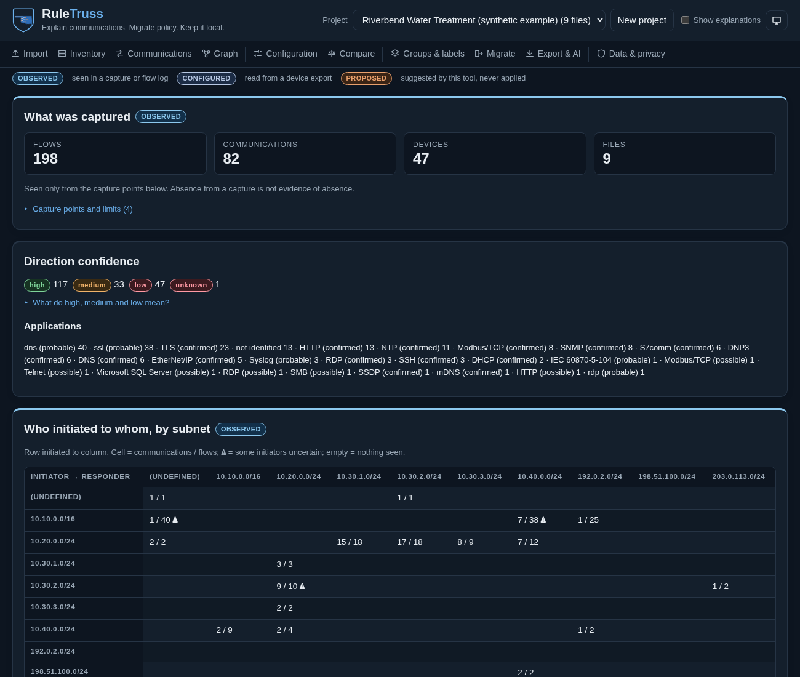
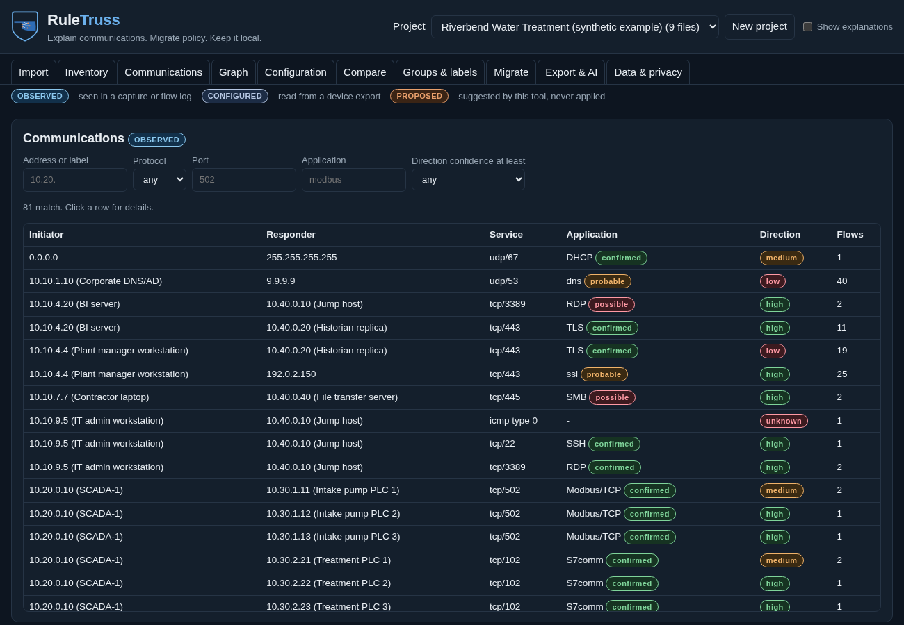
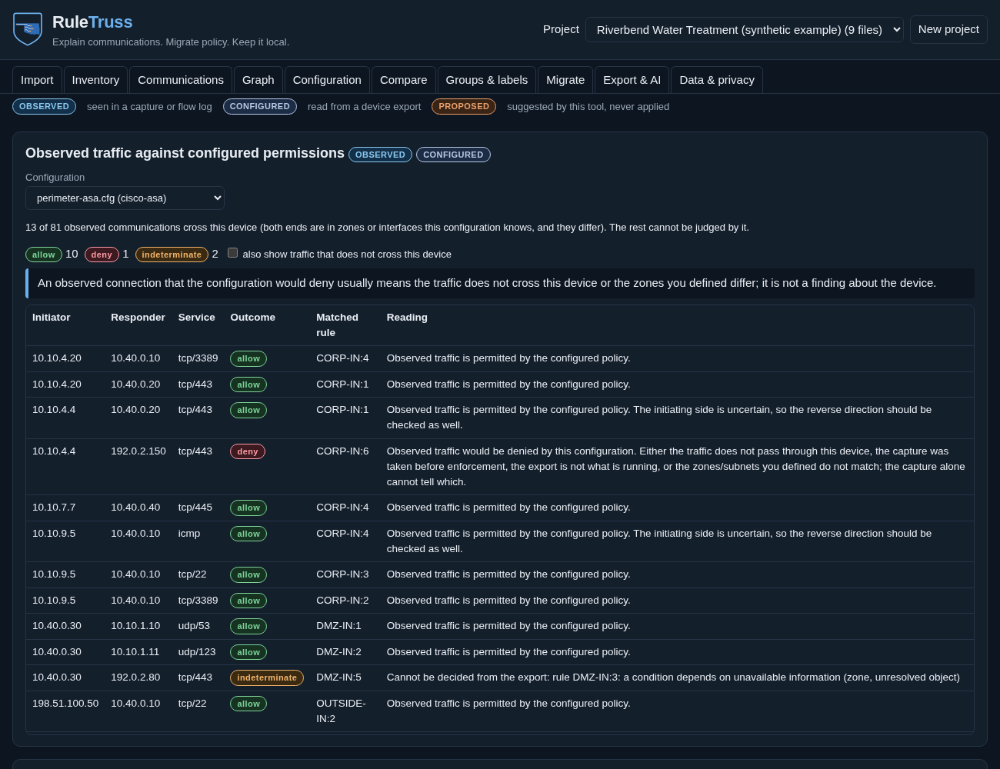
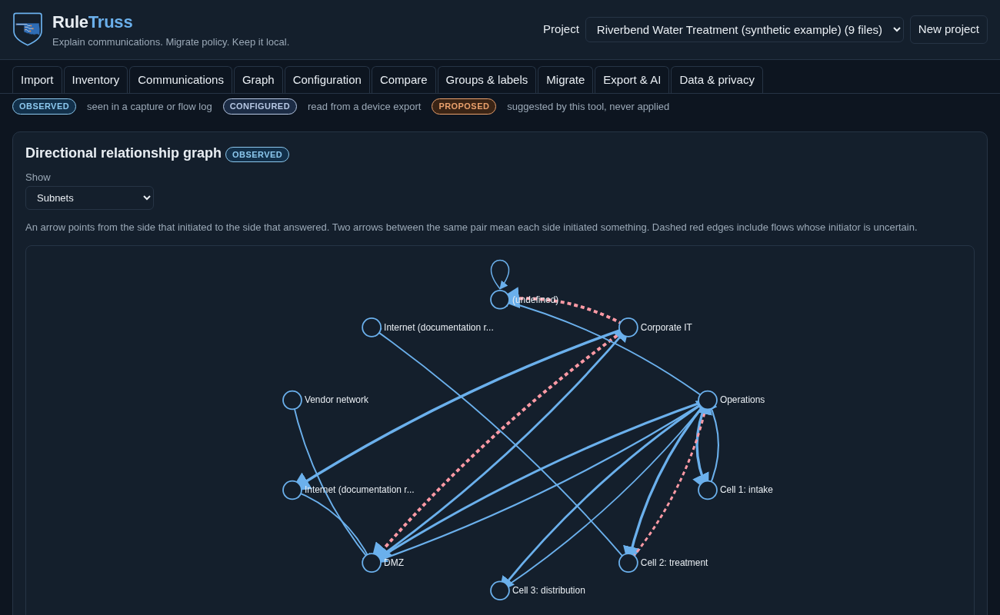
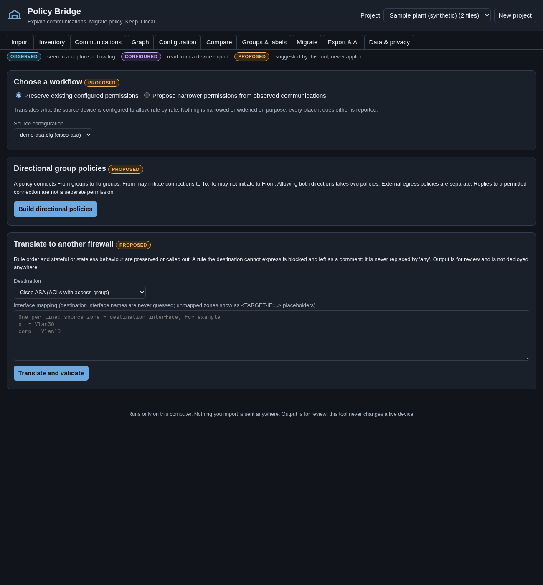

# RuleTruss

*by OkieOTSec*

A local-first, self-hostable workbench that helps network and security people **understand existing communications** and **migrate security policy** between products, without buying any particular vendor's hardware.

It reads packet captures, flow logs and firewall / router / switch exports; explains in plain language who talks to whom, who started it, on what, and what the existing rules permit; compares the two; and produces **reviewable** proposals: directional group-policy worksheets and rules for another firewall. It never touches live equipment.



> Status: version 0.1.0, pre-release. The adapters are tested against synthetic fixtures, not against real exports from every software version (see [docs/SUPPORT_MATRIX.md](docs/SUPPORT_MATRIX.md)). Nothing here is endorsed by or certified with any vendor.

## How this project was made, and what has and has not been reviewed

RuleTruss is directed by an OT security practitioner (OkieOTSec), who decides what it must do, supplies the network and security domain knowledge,
and judges its output from that point of view. The practitioner is not a programmer and does not read the code line by line. **The code was written by an
AI model** (Anthropic's Claude, through Claude Code). Quality is therefore argued from evidence, not from who wrote it:

* The code was reviewed twice by other AI models, not by the one that wrote it (OpenAI Codex, then GitHub Copilot; see [reports/](reports/): CP15 and CP16), and every confirmed finding that was fixed has a test that fails without the fix. They found different problems, one of them a mistake I had introduced in the first round, which shows what a single review misses.
* It is checked by static analysis, secret and dependency scanners, a coverage-guided fuzzer (Atheris) and a dynamic web scanner (OWASP ZAP), and its ASA output was compared with an independent parser (Batfish).
* **No person has reviewed the code**, and no translation has been loaded on a real firewall yet.

So: treat this as **experimental**, treat every generated configuration as **a proposal for the person who owns that firewall to review**, and do not apply one to a
production device without that review. Review by people who read Python, or who run these firewalls, is welcome; see [SECURITY.md](SECURITY.md) for how to report what you find.

## What it does

* **Shows it, and lets you dig in.** A graph you can resize, zoom and drag; click a circle, a subnet or an arrow to see who it talks to, what services it offers and uses, and a small sample of the traffic with how sure each statement is. Tabs that are not ready yet say so and tell you what to do.
* **Explains communications.** Devices and subnets, a filterable communication list, a who-initiated-to-whom matrix, a directional graph. Every statement carries its evidence (packet numbers, config lines or rule ids) and its confidence. Example, as the application writes it:
  > 10.20.1.15 (labelled "Engineering workstation") initiated 1 TCP connection to 10.30.2.40 (labelled "PLC-1") on destination port 44818. EtherNet/IP was identified from packet decoding (decoded EtherNet/IP encapsulation header (command RegisterSession, length 4 matches the data, session 0x0) in packet 28).

  If only the port is known it says the protocol is *possible*. It never infers what a device is from its traffic, and never reads silence in a capture as absence.
* **Identifies devices passively.** MAC addresses with how sure the attribution is (ARP or DHCP confirmed, or only probable), the card maker from the IEEE vendor-prefix listings (downloaded by you with one button; nothing is bundled), and what devices say about themselves (LLDP, DHCP host name, SNMP, Modbus and EtherNet/IP identity, HTTP and SSH banners), each labelled self-reported or weak hint. Randomised MACs and router MACs are called out, not guessed at. Nothing is ever sent to a device.
* **Infers initiation honestly.** A TCP SYN gives high confidence; a mid-stream capture, one-way UDP or an ambiguous exchange gets medium, low or unknown, with the reasons. Replies are never counted as reverse initiation.
* **Reads configurations** from Cisco ASA, Cisco IOS/IOS-XE ACLs, Palo Alto PAN-OS, Fortinet FortiOS and pfSense/OPNsense into one vendor-neutral model, resolving nested objects, keeping provenance, and reporting (never ignoring) what it cannot evaluate: applications, identities, schedules, FQDN objects and more.
* **Compares observed with configured.** Which rule would permit or deny each observed connection, which allow rules matched nothing (not "unused"), and shadowed, redundant, conflicting and over-broad rules.
* **Proposes policies, in two clearly labelled workflows.** *Preserve* what is configured, or *propose narrower* permissions from what was observed (with the observation period, held-back uncertain directions, and an acknowledgement before export). Output is either **directional group policies** (From groups may *initiate* to To groups; the reverse is its own policy; a separate external-egress policy type), or **rules for another firewall** (Cisco ASA, Cisco IOS, FortiOS).
* **Never silently widens.** A condition the destination cannot express blocks the rule and says why, instead of becoming "any". Group aggregation that grants pairs nothing supported, lost restrictions, and deny rules that cannot be carried over are all counted in a verdict line.
* **Validates the migration** by rendering the destination text, parsing it back and comparing allow/deny decisions on sampled connections, classifying any difference, and printing why this does not prove equivalence.

## Supported formats

| Kind | Supported now | Not yet |
| --- | --- | --- |
| Packet captures | PCAP, PCAPNG (Ethernet, raw IP, Linux cooked, loopback; IPv4, IPv6, VLAN) | |
| Flow records | Zeek conn.log (TSV, JSON lines) | NetFlow/IPFIX, firewall traffic logs |
| Configuration sources | Cisco ASA, Cisco IOS/IOS-XE ACLs, PAN-OS XML, FortiOS CLI, pfSense and OPNsense config.xml, UniFi zone-based firewall (JSON from `tools/unifi_export.py`; see [docs/EXPORT_UNIFI.md](docs/EXPORT_UNIFI.md)) | Cisco FTD, Juniper SRX, Check Point |
| Destination rules | Cisco ASA, Cisco IOS, FortiOS | PAN-OS, SRX, Check Point, pfSense |
| Directional group policy | Worksheets (Markdown, JSON, CSV) | Native import files (the model is this project's own, not any product's format) |

Details, the candidates considered and the versions the fixtures stand for: [docs/SUPPORT_MATRIX.md](docs/SUPPORT_MATRIX.md). Official documents behind each vendor behaviour, and what could not be verified: [docs/SOURCES.md](docs/SOURCES.md).

## Setup

Needs Python 3.12 or newer, on Linux or macOS. One runtime dependency (dpkt), installed with hash checking.

```bash
python3 -m venv .venv
.venv/bin/pip install --require-hashes -r requirements.txt
.venv/bin/python -m ruletruss          # prints an address with a one-time access token
```

Open the printed address (`http://127.0.0.1:8765/#token=...`) in your browser. Everything is stored in `~/.local/share/ruletruss` (change with `--data-dir`). Nothing leaves the machine. To try it with no files of your own, press **Create the Riverbend example** on the Import tab (see *Example data* below).

**Big captures.** The defaults (512 MB, 5,000,000 packets, 200,000 flows, 10 minutes, 2 GB of memory per file) guard against hostile or broken files. For a large capture you trust, raise them when you start the server, for example for a 3 GB file:

```bash
.venv/bin/python -m ruletruss --max-capture-mb 4096 --max-packets 60000000 --parse-minutes 90 --parse-memory-gb 4
```

Files over 32 MB are imported in the background with a progress line and a Stop button, so the browser never waits on one long request. Allow free disk space for the original file plus its analysis. Details and measurements: [docs/LIMITATIONS_AND_ROADMAP.md](docs/LIMITATIONS_AND_ROADMAP.md).

Options: `--max-capture-mb`, `--max-packets`, `--max-flows`, `--parse-minutes`, `--parse-memory-gb`, `--port`, `--data-dir`, `--retention-days N` (delete old projects at start), `--ai-endpoint URL` (optional, off by default; see [SECURITY.md](SECURITY.md)). A container or reverse proxy is not needed, and the server refuses non-loopback addresses unless you pass `--allow-non-loopback`.

## Using it

1. **Import** captures and exports (drag and drop). Say where a capture was taken; the tool never guesses.
2. **Groups & labels:** define subnets (with the zone or interface name a rule would use), label devices, and define groups. Endpoints can be in several groups.
3. **Inventory, Communications, Graph:** read what was seen.
4. **Configuration and Compare:** read what is configured and how it meets what was seen.
5. **Migrate:** build directional group policies (preserve or narrower), or translate to another firewall and read the validation.
6. **Export:** worksheets and configuration text for review. Delete anything on **Data & privacy**.

## Example data

You do not need your own captures or exports to understand the design. Three synthetic data sets are included, all fictional:

* **[samples/riverbend/](samples/riverbend/)**: a fictional water-treatment plant with **three captures taken at different points** (a clean span, a sparse DMZ tap, a capture that started mid-conversation), a **Zeek flow log**, and **five device exports in five formats** (Cisco ASA, PAN-OS, FortiOS, Cisco IOS ACLs, pfSense), plus `context.json` (subnets, labels and groups). It is built to show every idea in the tool, including where the tool says *I cannot tell*. Start with **[samples/riverbend/GUIDE.md](samples/riverbend/GUIDE.md)**, which lists what to look for, where, and why it matters; each point in it is checked by an automated test. Load it with one button, or import the files by hand.
* **[samples/small/](samples/small/)**: one capture, one flow log and one configuration per format; quicker to read.
* **[samples/unifi/](samples/unifi/)**: a zone-based UniFi gateway export with a small capture inside its networks, including a classic mistake (a block for all states that also drops replies). One button loads it.

Regenerate them with `python tools/make_samples.py`. **New to the tool? Start with the [training guide](docs/TRAINING.md)**: ten labs on these examples, with check questions and answers.

## Walkthrough, with real outputs

[docs/WALKTHROUGH.md](docs/WALKTHROUGH.md) takes the synthetic sample from input files to explanations to exports, regenerated from the application code by `tools/make_demo.py`. The full output files are in [docs/demo/](docs/demo/); sample inputs are in [samples/small/](samples/small/).

| | |
| --- | --- |
|  |  |
|  |  |

## Architecture in one paragraph

A small Python server (standard library plus dpkt) serves a vanilla-JavaScript page under a strict Content-Security-Policy. Each upload is parsed in a separate, resource-limited process into the vendor-neutral model: *observed* flows, *configured* rules and *proposed* plans are kept in separate structures and labelled everywhere. Evaluation is three-valued, so "cannot tell" is never confused with "no". Details: [docs/ARCHITECTURE.md](docs/ARCHITECTURE.md); the schema and the directional model: [docs/MODEL.md](docs/MODEL.md).

## Tests and validation

* **291 automated tests**, all passing (`python -m unittest discover -s tests -t .`, about 70 seconds): object and nested-group resolution, ordered rules and implicit deny, stateful replies versus reverse initiation, stateless return requirements, NAT address context, IPv6/UDP/ICMP, shadowed/conflicting/disabled rules, group aggregation, unsupported applications/identities/schedules, hostile files and resource limits, fuzzing, the server's access control, and the interface in a real headless browser (25 checks).
* **Migration validation evidence:** [docs/VALIDATION.md](docs/VALIDATION.md) lists every fixture translated to every other destination and compared on sampled connections, including the differences found and why.
* **Security testing** follows [SECURITY_TEST_PLAN.md](SECURITY_TEST_PLAN.md); reports are archived in [reports/](reports/). One runtime dependency, with an [SBOM](sbom/sbom.cdx.json). [docs/SECURITY_FRAMEWORKS.md](docs/SECURITY_FRAMEWORKS.md) maps the practice to the NIST SSDF and MITRE SAF, with the evidence and what is still open (a self-assessment, not an audit).
* The browser tests and screenshots run in headless Chromium with no display, so no window ever opens on your desktop.

## Limitations and what is next

Read [docs/LIMITATIONS_AND_ROADMAP.md](docs/LIMITATIONS_AND_ROADMAP.md). The short version: application, identity and schedule conditions are reported but not evaluated; FQDN objects are not resolved; translations are proposals that have not been loaded onto a device; the validation uses this tool's own evaluator on both sides; observed traffic is not business need; and directional rules are not a complete zero trust architecture.

## Licence and brand

The code is MIT licensed ([LICENSE](LICENSE)). The OkieOTSec name and logo in `assets/brand/` and `ruletruss/web/brand/` are not part of that licence; see [assets/brand/README.md](assets/brand/README.md). A fork must use its own name and logo. RuleTruss ships no IEEE data: the vendor-prefix listings are downloaded by the user on request (see [docs/SOURCES.md](docs/SOURCES.md) for why).
